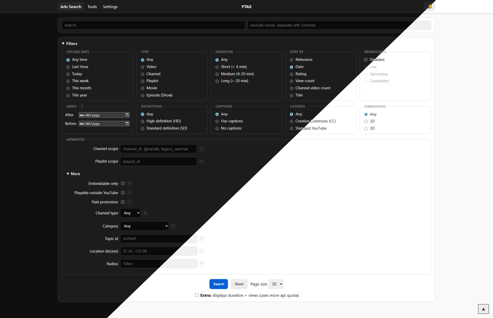

# yt-adv-search

<picture></picture>
[](./LICENSE)
[](https://deepwiki.com/sekedus/yt-adv-search)

<details>
<summary><strong>Preview</strong></summary>

<picture></picture>
</details>

<br>

A fast, simple YouTube search page with filters that YouTube itself removed, like
**Last Hour** and **sort by Rating/Date**. It also has shortcuts for searching inside
one channel or playlist.

No login. No build step. Just open it in your browser and search.

## What can you do with it?

### Search page (`/`)

Type a keyword, and optionally some words to exclude. Every text field has a small ✕
that clears it.

Open **Filters** to narrow results by:

- upload date, or an exact date range;
- type, duration, and broadcast status;
- video quality: definitions, captions, licenses, and dimensions;
- sort order.

Filters are kept in the page URL, so you can bookmark or share a search.

Inside a channel or playlist, videos that YouTube treats as Shorts get a **Shorts**
badge.

### Search shortcuts

Type these straight into the search box:

- `channel:UCK8sQmJBp8GCxrOtXWBpyEA space` searches inside one channel. Put the channel
  ID after `channel:`, then a space, then your words.
- `handle:@madebygoogle health` does the same with a channel's @handle.
- `user:youtube dance` uses an old-style username instead.
- `playlist:PLbpi6ZahtOH57M7nNfcy_eAOdtptnAYX8 lego` searches inside one playlist.
- `after:2024-01-01 before:2024-06-01 watch` keeps only videos from that date range.

### Tools page (`/tools`)

Paste a channel URL, `@handle`, channel ID, legacy username, or a bare name. The page
finds the channel ID and gives you:

- links to the channel;
- an **Invidious** button;
- a button to use the channel in search.

A bare name checks `@name`, `/user/name`, and `/c/name`, then shows every distinct
channel it finds, with the matching forms on each card. An explicit URL or the input
kind menu resolves one exact form only. `/c/` names are read from the fixed YouTube
channel page.

The status line shows the channel (or how many channels were found) and adds `(cached)`
when the answer came from cache. The **Refresh** button next to it skips the 7-day
resolver cache.

### Settings page (`/settings`)

Pick a theme (Auto, Dark, or Light), page size, SafeSearch, region, language, and how
long search results may be cached (30 minutes by default).

Channel lookups use a fixed 7-day cache and categories a fixed 1-month cache. Settings
are stored only in your browser.

## How it works

```text
Your browser → Cloudflare Worker → YouTube's official API → back to you
```

Your YouTube API keys live **only on the Worker**, never in the web page.

The Worker:

- forwards your search to Google and rotates through your keys if one fails;
- skips quota-exhausted keys until midnight UTC;
- caches repeat searches for 30 minutes by default to save quota;
- caches channel lookups for 7 days and the category list for 1 month;
- fetches fresh categories when the Region setting changes.

It refuses `/api/*` requests from other websites, so other sites cannot use your quota.
Localhost is allowed for development.

Shorts badges try a lightweight HEAD check first and fall back to the API only when that
is unclear. A repeat search is cheap because each result is cached for a day.

Resolver `/c/` lookups read the fixed YouTube channel page (no cookies, no API key). All
other resolver calls go to the Google API. A bare name may take a moment on its first
lookup.

Search links write a space in `q` as `%20`. A literal `+` stays a plus, so use `%20`
for spaces.

## Getting started

### Prerequisites

- A **Cloudflare account** ([sign up](https://dash.cloudflare.com)).
- **Node.js 22+** ([download](https://nodejs.org/en/download/)).
- **Git** ([download](https://git-scm.com/downloads)).
- A **YouTube Data API v3 key**.

### Get a YouTube API key

1. Go to [Google Cloud Console](https://console.cloud.google.com/) and sign in.
2. Create a project (any name, for example `yt-adv-search`).
3. Open **APIs & Services** → **Library**, find **YouTube Data API v3**, and click
   **Enable**.
4. Open **APIs & Services** → **Credentials** → **Create credentials** → **API key**.
5. Give it a **Name**, choose **Select API restrictions**, tick **YouTube Data API v3**,
   then click **Create**.
6. Copy the key (it looks like `AIzaSy...`).

Need more quota later? Add more keys separated by commas. The app rotates through them
automatically.

## Get running

Pick the option that suits you. All three give you the same result: search, tools, and
settings in one Worker.

### Option A: Deploy button

Click the button to deploy straight from the Cloudflare dashboard:

[](https://deploy.workers.cloudflare.com/?url=https://github.com/sekedus/yt-adv-search)

1. You land in the **Cloudflare dashboard**.
2. Connect your **GitHub** account.
3. Give the Worker a name (for example `yt-adv-search`) and click **Deploy**.
4. When the build finishes, add your API key as described in
   [Add your API key](#add-your-api-key).

### Option B: Cloudflare dashboard

1. Fork this repository to your GitHub account.
2. In the Cloudflare dashboard, open **Workers & Pages** and click **Create application**.
3. Connect GitHub, select your fork, and click **Deploy**.
4. When the build finishes, add your API key as described in
   [Add your API key](#add-your-api-key).

### Option C: Local PC

Run the app on your own computer. This is a good way to try it before going online.

```text
git clone https://github.com/sekedus/yt-adv-search
cd yt-adv-search
cp .env.example .env
```

Open `.env` in any text editor and paste your key:

```text
YOUTUBE_API_KEYS=YourYoutubeApiKeyV3Here
```

For two keys, use `YOUTUBE_API_KEYS=key1,key2`. This file is git-ignored, so your keys
never get committed.

Start the app:

```text
npx wrangler dev
```

Open the address it prints (usually http://localhost:8787). Try
`handle:@madebygoogle fold` and press **Search**.

To publish it later:

```text
npx wrangler login
npx wrangler secret put YOUTUBE_API_KEYS
npx wrangler deploy
```

The second command stores your key safely on Cloudflare. The third publishes the app.
Search, tools, settings, and the API all come from the one Worker.

### Add your API key

The app cannot search without a key.

#### Online (Options A, B, or a deployed Option C)

1. In the Cloudflare dashboard, open **Workers & Pages** → your Worker.
2. Go to **Settings** → **Runtime variables and secrets**.
3. Click **Add variable**, name it `YOUTUBE_API_KEYS`, and paste your key (or
   comma-separated keys) as the value.
4. Click **Add variable and deploy**.

No code changes are needed.

#### Local development (Option C)

Put the key in `.env` as shown above.

## Everyday use

- **First search to try:** `handle:@madebygoogle pixel` with the **This month** filter.
- **Share a search:** copy the page URL after searching. Filters and shortcuts are in
  the link.
- **Save quota:** leave **Extra duration + views** off in Settings unless you need it.
  Raise **Max cache time** if you repeat searches (30 minutes by default). Search
  results follow that setting; channel lookups (7 days) and categories (1 month) are
  fixed.
- **Proxy check:** **Check proxy** in Settings only checks that the Worker answers. It
  never spends quota and never shows keys.

## About quotas (why searches sometimes stop)

YouTube gives each API key about **10,000 units per day**, reset at 00:00 UTC. One
normal search costs about **100 units**, so one key covers roughly **100 searches a day**.

The app stretches this by caching repeat searches and rotating keys. If every key is
used up, it shows a clear message instead of leaking anything.

Shorts detection starts with free HEAD checks. Only unclear results fall back to the
Data API (usually a few per search, up to 40 if YouTube blocks the HEAD check), and
each result is cached for a day.

More details:
[YouTube Data API quota usage](https://developers.google.com/youtube/data/getting-started?hl=en#quota).

## If something goes wrong

- **`Server misconfigured: no API keys`** means the Worker has no key. Check `.env`
  locally, or add the `YOUTUBE_API_KEYS` secret in the dashboard (or run
  `npx wrangler secret put YOUTUBE_API_KEYS`).
- **`YouTube API request failed` with `quotaExhausted: true`** means all keys hit
  today's limit. Wait for the daily reset, or add another key.
- **Empty results** usually means the filters are too narrow, or a
  `channel:`/`playlist:` ID has a typo. Loosen the date filter and check the ID in
  `/tools`.
- **`Forbidden origin`** means `/api/*` was called from another website. Use this
  Worker's own pages; localhost is allowed for development.
- **Page looks unstyled or 404 on `/styles.css`** means the dev server is serving from
  the wrong folder. Run `npx wrangler dev` from the repo root (where `wrangler.toml`
  is).
- **Settings don't stick** means the browser blocks `localStorage`. Allow site data, or
  use a normal (non-private) window.

## Project layout

```text
worker.js        Cloudflare Worker: pages + /api/* (origin check, keys, cache, Shorts checks)
public/          The website: index.html, tools.html, settings.html, styles.css, favicon.png
wrangler.toml    Worker config: serves ./public as static assets
.env.example     Template for local keys (copy to .env; never commit real keys)
```

## For contributors

- `dev/project.md` covers scope and stack.
- `ARCHITECTURE-MAP.md` shows where code lives.
- `dev/verification.md` explains how changes are proven.
- `dev/roadmap.md` lists milestones and tasks.

## Notes

- Vanilla HTML, CSS, and JavaScript. No build step and no database.
- Modern browsers only.
- Secrets never leave the Worker.
- Search enrichment stays **OFF** by default to save quota.

## Similar projects

- [mkuchak/youtube-advanced-search](https://github.com/mkuchak/youtube-advanced-search?tab=readme-ov-file#readme)
- [flazeIguess/zerodig](https://github.com/flazeIguess/zerodig?tab=readme-ov-file#readme)

## Disclaimer

This project is not affiliated with, endorsed by, or sponsored by Google or YouTube. It
uses the official YouTube Data API v3 under the
[YouTube API Terms of Service](https://developers.google.com/youtube/terms/api-services-terms-of-service).

## License

[GNU General Public License v3.0](./LICENSE)
